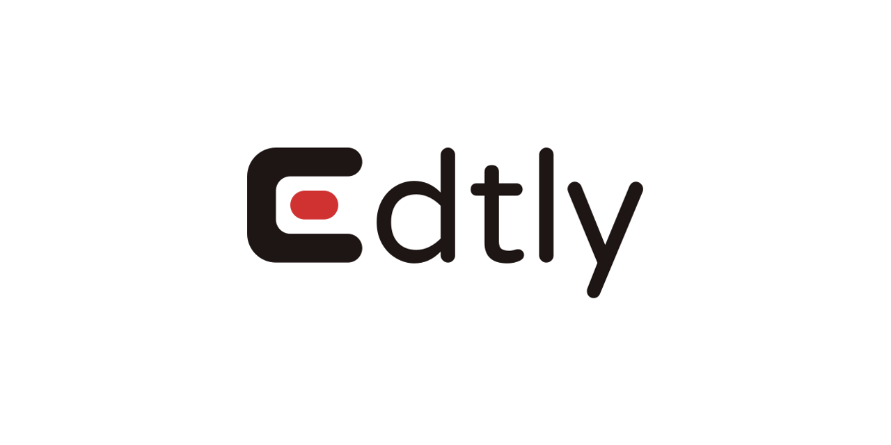
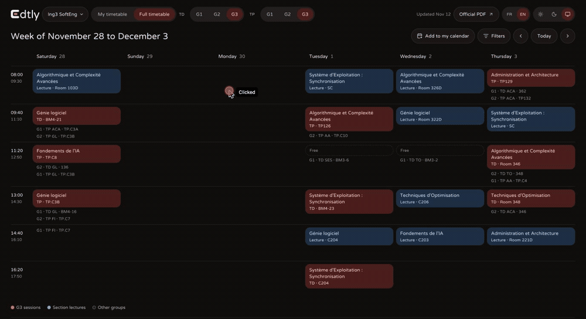

<p align="center">
  
</p>

<p align="center">
  
</p>

# Edtly

Live at **[edtly.microclub.info](https://edtly.microclub.info)**.

Unofficial timetable viewer for students of the USTHB Faculty of Informatics (LMD and Ingénieur). Data comes from the PDFs published on [finfo.usthb.dz](https://finfo.usthb.dz/etudes/emploi-du-temps).

## Scripts

```bash
bun install
bun run dev
bun run build
bun run start
bun run lint
bun run typecheck
bun test
```

Next.js runs on Node. Bun is the package manager and script runner. `bun --bun next build` does not work with Next 16.4.6.

## Timetable data

There is one JSON file per programme, at `data/<system>/<level>/<speciality>.json`, for example `data/lmd/l2/isil.json`. The file name must match `speciality.id`. Each file is validated with Zod at build time (`lib/timetable/schema.ts`). An invalid file is not published: its page shows the official PDF link instead.

```json
{
  "system": "lmd",
  "level": "l2",
  "speciality": { "id": "isil", "name": "ISIL" },
  "academicYear": "2026/2027",
  "semester": 1,
  "status": "published",
  "source": { "title": "Emploi du temps L2 ISIL", "url": "https://finfo.usthb.dz/storage/disk/….pdf", "updatedAt": "2026-11-05" },
  "sections": [
    {
      "id": "a",
      "name": "A",
      "groups": ["G1", "G2", "G3", "G4"],
      "sessions": [
        { "day": "mon", "start": "08:00", "end": "09:30", "type": "td", "module": "SEM300", "room": "162", "teacher": "HEDJAZI-DELLAL", "groups": ["G1"] },
        { "day": "mon", "start": "11:20", "end": "12:50", "type": "cours", "module": "ALGO2", "room": "149T", "teacher": "LAICHI", "groups": [] }
      ]
    }
  ]
}
```

- `day`: `sat` `sun` `mon` `tue` `wed` `thu`
- `type`: `cours`, `td` or `tp`
- `groups`: an empty list means the whole section (shared Cours)
- `status`: `"unsupported"` hides the sessions and links to the PDF

After you edit a file, run `bun test` and deploy. Each programme, section and group page is generated at build time. The service worker version changes with each deployment, so installed apps get the new timetable.

## Calendar

Students can add their timetable to Google Calendar from the calendar button. The subscription URL is `/api/calendar/<token>.ics`, where the token is the parcours and personal choices (hidden modules, module groups, retake modules) encoded in base64url JSON (`lib/calendar/token.ts`). No account or database is involved. The feed is generated from the deployed data on each request, so subscribed calendars pick up a new timetable on their next refresh. Google refreshes subscriptions on its own schedule, usually within 24 hours.

Classes repeat weekly from the week of `source.updatedAt` until the end of the semester: 31 January for semester 1 and 30 June for semester 2 (`lib/calendar/term.ts`). Change these dates there once the faculty publishes its calendar.

## Session overrides

Students can move, edit or cancel their own classes. They drag a class to another day or time slot (mouse, touch with a long press, or keyboard: Space to pick up, arrow keys, Space to drop), or open it and choose Edit or Cancel. Each change applies to one week only or to every week from that week until the end of the semester (`lib/calendar/term.ts`).

Overrides are stored in `localStorage` (`edtly:overrides`), per section, keyed by the official session (`sessionKey`). The timetable JSON is never modified. `lib/timetable/overrides.ts` resolves them for the week on screen before filters, conflicts, the now/next card and free periods are computed. A one-week change wins over an every-week change, and a new every-week change replaces the changes after it. When the faculty publishes a new timetable, overrides whose session no longer exists stop applying.

The calendar token also carries the overrides (hashed session keys, at most 40), so the feed includes moved, edited and cancelled classes (`lib/calendar/occurrences.ts`). Google Calendar keeps the URL it was given, so after a change the student has to add the updated calendar and remove the old one. Edtly only records that the Google link was opened, never that the sync succeeded.

## Deployment

Production runs as a Docker image on the Micro Club dokploy server at `https://edtly.microclub.info`. CI builds the image and pushes it to GHCR on every push to `main`; dokploy pulls it. See [`DEPLOY.md`](DEPLOY.md) for the pipeline, the one-time setup and rollbacks.

```bash
docker build -t edtly .            # from the repository root
docker run --rm -p 3000:3000 edtly
```

The Vercel deployment keeps working: the `bun.lock` file selects Bun for the install, and `bunVersion` must not be set in `vercel.json`. Set `NEXT_PUBLIC_SITE_URL` to the production URL; it is used for canonical links, the sitemap and Open Graph (the Docker build sets it to `https://edtly.microclub.info`).
